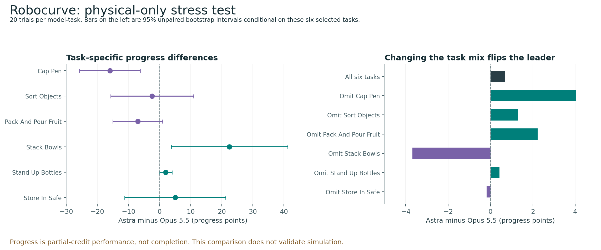

# Trusting Simulation

**When do proxy benchmarks support real-world robot policy selection?**

Independent research by Eric Modesitt, October 2026. This audit reanalyzes
published results; it performs no new robot trials, simulator rollouts or
robot-policy training/inference.

**Main finding:** matched simulation often preserves physical policy rankings,
but consequential task-level reversals remain. Better prediction of benchmark
scores also need not produce better model selection. Simple baselines are strong,
and protocol compatibility determines which transfer claims can be tested at all.

| Study | Completed finding | What it establishes |
| --- | --- | --- |
| SIMPLER | Matched simulation orders **61/65 Google Robot** and **8/9 WidowX** material-gap pairs correctly; task-aware calibration adds no ranking improvement. | Matched sim/physical evidence for these published tasks and policies. |
| Robocurve | Audited **360 physical trials**. Astra leads Opus 5.5 by only **0.68 progress points** overall; dropping particular tasks reverses the leader. | Sensitivity of a physical benchmark to task selection; no paired simulation test. |
| RoboDojo | Recovered **180 physical method-task score cells**, but simulation and physical results use unpaired tasks and separately fine-tuned policies. | A boundary on valid transfer claims, despite shared method names. |
| RoboTwin | For **25 policies × 50 tasks**, ten observed task scores yield **82.5% clean / 91.5% randomized** material-gap ranking agreement with an anchor average. | Held-out policy prediction on known simulated tasks. |
| LIBERO-Plus | Verified **361,080 binary outcomes**. More evaluated training checkpoints improve Brier score; a simple offset ranks better than the latent model. | Within-family missing-result prediction in simulation. |

Material gaps mean at least 10 percentage points in observed outcomes; they do
not certify the true gap. Pairs overlap and are not independent samples. The last
two studies are simulation-only and provide no additional physical-transfer validation.

## Read the report

- [Technical overview, methods and limitations](docs/technical-report.md)
- [Original two-page physical-evidence note](reports/Trusting_Simulation_Research_Note.pdf)
- [Detailed experiment reports and summary tables](reports/)
- [Reproduction and data availability](docs/reproduction.md)
- [Third-party notices and redistribution decisions](THIRD_PARTY_NOTICES.md)



## Reproduce

The licensed **SIMPLER and LIBERO-Plus** studies rerun directly from the public
checkout. Python 3.11 is the verified release environment:

```bash
python3.11 -m venv .venv
source .venv/bin/activate
python -m pip install -r requirements-lock.txt
OPENBLAS_NUM_THREADS=1 OMP_NUM_THREADS=1 python -m src.reproduce_public
```

This offline command regenerates both studies and runs their 24 applicable tests.
It needs no recovery ZIP. GitHub Actions runs the same public subset.

**Complete audit:** the full multi-benchmark pipeline also passes from a clean
checkout, using exact inputs imported from the original recovery archive:

```bash
python scripts/acquire_inputs.py --archive /path/to/Trusting_Simulation_Analysis.zip
OPENBLAS_NUM_THREADS=1 OMP_NUM_THREADS=1 python -m src.reproduce
```

**Data availability limitation:** four RoboDojo website/paper snapshots can no
longer be reacquired with their original hashes. The complete run requires those
bytes from the recovery archive, which is deliberately not redistributed. This
is not a self-contained public release of every dataset. The
[reproduction record](docs/reproduction.md) lists the exact availability checks
and clean-run evidence; [third-party notices](THIRD_PARTY_NOTICES.md) explain the
redistribution decisions.

The full pipeline checks source and frozen-plan hashes, rebuilds processed data,
runs every experiment including the three RoboTwin model sweeps and LIBERO-Plus,
regenerates reports/figures, and runs all 63 tests. Generated results go to
`results/`, processed data to `data/processed/`, and the PDF to `output/pdf/`.
These large outputs are excluded from Git; selected report assets are included.

## Interpretation

SIMPLER was designed around its real robot setups. Holding out calibration labels
does not hold out simulator design. Its nine task entries and related checkpoints
support a narrow conclusion. Robocurve's six tasks were selected using Astra
performance; partial progress differs from completion. RoboDojo's protocol mismatch
blocks a formal task-level transfer test. RoboTwin and LIBERO-Plus hold out policies
or checkpoint groups on known tasks, with incomplete ancestry separation.

The contribution is a reproducible evaluation method and an account of what the
available evidence supports. There is no new simulator, demonstrated superior
ranking algorithm, or validated rule for skipping physical tests.

Original code and writing: MIT. Upstream files retain their own licenses and
notices. This work is not commissioned or endorsed by any benchmark organization.
