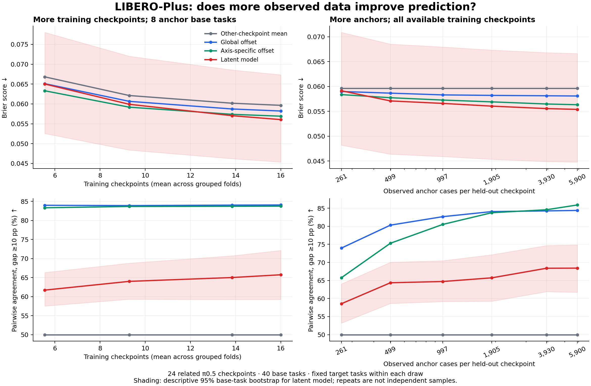

# LIBERO-Plus: scaling prediction from public binary outcomes

This is an independent missing-result prediction study, not a new robot-policy evaluation or a sim-to-real validation.

**Main finding:** More training checkpoints improve the latent model's binary probability predictions: Brier falls from 0.0650 to 0.0561 as the average training set grows from 5.6 to 16 checkpoints, a 13.8% reduction. The paired base-task bootstrap interval for the change is [-0.01095, -0.00713], conditional on this checkpoint cohort. But at eight anchor tasks, latent ranking agreement is only 65.7%, versus 84.1% for the simple global-offset model. The latent predictor's better success-rate MAE (4.31 versus 5.01 points) does not translate into better model selection.

Compared with the stronger axis-specific offset baseline, the latent Brier advantage is small: -0.00086, with descriptive paired interval [-0.00180, +0.00007]. Under the stricter camera/noncamera holdout, its Brier is 0.06392 versus 0.06340 for the axis-specific baseline. These results support an empirical data-scaling trend, but not a robust claim that latent modeling is the best predictor or ranking method.

## Data and effective sample size

Source: [Targeted Data Sets for π0.5 on LIBERO-Plus](https://github.com/Alakazam-studios/targeted-data-libero-plus), pinned commit `554a0d06924f64f15551119e393373a9bc008771`. Apache-2.0 code and results; original README, NOTICE, license, manifest, and all 36 result files are preserved. The records originate from the paper authors, not an independent benchmark rerun. We checked compressed and uncompressed SHA-256 hashes, case alignment, binary outcomes, and reproduced all 36 published seven-axis means.

The public release has 361,080 outcomes, 36 passes and 29 weight files. The primary cohort has **24 distinct checkpoints × 10,030 cases = 240,720 binary observations**. We exclude changed-prompt/rewriter configurations and other evaluation protocols, and use only run A's first pass in prediction. The extra pass is reserved for the noise diagnostic. These cases derive from **40 base tasks**, four suites, seven perturbation axes, and five nominal difficulty levels. Difficulty labels are retained as source metadata; we do not assume equal numerical difficulty across axes.

All primary checkpoints share π0.5. Nine frozen intervention groups keep related seed replicates and ablations together; they are **not nine independent model families**, and cross-group parents remain. A stricter camera versus noncamera sensitivity further restricts training. Broader model-family generalization cannot be tested here.

The cohort's mean binary success is 90.76%. Of 10,030 cases, 4,969 succeed for every checkpoint, 121 fail for every checkpoint, and 4,940 vary between checkpoints. An always-success classifier would therefore already have high accuracy, which is why accuracy is not our primary metric.

## Prediction setup

For a held-out checkpoint, reveal the outcomes on some anchor base tasks and predict outcomes on 16 other base tasks. All variants of a base task stay on the same side for that held-out checkpoint. Training checkpoints supply outcomes on the target cases: this is **missing-cell prediction on known benchmark tasks**, not prediction on a task unseen by every checkpoint. No held-out checkpoint's target labels enter training or hyperparameter selection.

We use three repeated three-fold intervention-group partitions and three nested anchor orders. Each anchor order holds target tasks fixed while revealing 1, 2, 4, 8, 16 or 24 base tasks. Checkpoint scaling uses 25%, 50%, 75% or 100% of available training intervention groups with eight anchor tasks. Larger fractions retain the smaller training sets. The two horizontal axes therefore mean different resources: training checkpoint evaluations versus additional observations of the held-out checkpoint. They are not robot training data or robot training compute.

TaskMean averages other checkpoints' binary outcomes on each case. AnchorMean predicts the held-out checkpoint's average anchor success everywhere. Additive adds one anchor-estimated offset to TaskMean. AxisOffset estimates seven separate offsets. Neighbor3 averages the three training checkpoints closest on anchors. Latent learns a rank-limited basis of checkpoint-by-case variation; inner grouped validation selects rank and ridge using Brier score. All fitted probabilities are bounded to [0,1].

With centered training outcome matrix C, latent case factors V are the leading right singular vectors rescaled by sqrt(number of cases). For observed anchor vector s_A and training mean mu: z = (V_Aᵀ V_A / |A| + lambda I)^(-1) V_Aᵀ(s_A - mu_A) / |A|, and p_T = clip(mu_T + V_T z, 0, 1). No target observations of this checkpoint appear in this equation.

## Results at eight anchor base tasks and all available training checkpoints

| Method | Brier | Task × axis MAE (pp) | Ranking agreement (%) |
| --- | --- | --- | --- |
| TaskMean | 0.0596 | 4.97 | 50.00 |
| AnchorMean | 0.0854 | 8.49 | 83.82 |
| Additive | 0.0582 | 5.01 | 84.06 |
| AxisOffset | 0.0569 | 4.51 | 83.75 |
| Neighbor3 | 0.0656 | 4.41 | 61.37 |
| Latent | 0.0561 | 4.31 | 65.73 |

Brier is mean squared error on binary outcomes and is the primary proper scoring rule. MAE measures predicted versus observed success fractions within base-task × axis groups, rather than pretending each binary case is a measured success probability. Ranking compares jointly held-out checkpoints on these groups; observed differences below 10 percentage points are excluded and predicted ties count half. Repeated splits/pairs are not new independent samples. The endpoint covers 32 unique target base tasks across draws and 4,964 unique eligible (checkpoint pair, base task, axis) comparisons; these still share data. Task-axis groups have 4–50 cases. An exploratory reporting-only sensitivity restricts ranking to groups with at least 20 cases (`libero_plus_ranking_min20_sensitivity.csv`); it does not change model selection.

### Scaling the number of training checkpoints

| n_train | TaskMean | Additive | AxisOffset | Latent |
| --- | --- | --- | --- | --- |
| 5.6 | 0.0668 | 0.0651 | 0.0633 | 0.0650 |
| 9.3 | 0.0621 | 0.0607 | 0.0592 | 0.0599 |
| 13.9 | 0.0602 | 0.0587 | 0.0574 | 0.0570 |
| 16.0 | 0.0596 | 0.0582 | 0.0569 | 0.0561 |

### Scaling observed anchor cases of the held-out checkpoint

| n_anchor_cases | TaskMean | Additive | AxisOffset | Latent |
| --- | --- | --- | --- | --- |
| 260.7 | 0.0596 | 0.0590 | 0.0584 | 0.0592 |
| 498.7 | 0.0596 | 0.0587 | 0.0577 | 0.0571 |
| 997.3 | 0.0596 | 0.0583 | 0.0573 | 0.0566 |
| 1,905.3 | 0.0596 | 0.0582 | 0.0569 | 0.0561 |
| 3,929.7 | 0.0596 | 0.0581 | 0.0565 | 0.0556 |
| 5,899.7 | 0.0596 | 0.0581 | 0.0563 | 0.0554 |

These are empirical learning curves over the observed range. We have not fitted or established an asymptotic power-law scaling law. Detailed paired changes and descriptive base-task bootstrap intervals are in `libero_plus_paired_deltas.csv`; task-level values are in `libero_plus_by_task.csv`.

## Stricter camera versus noncamera intervention holdout

| Method | Brier | Ranking agreement (%) |
| --- | --- | --- |
| Additive | 0.0652 | 83.39 |
| AnchorMean | 0.0854 | 83.67 |
| AxisOffset | 0.0634 | 82.89 |
| Latent | 0.0639 | 61.92 |
| Neighbor3 | 0.0717 | 53.63 |
| TaskMean | 0.0674 | 50.00 |

This sensitivity puts all 15 camera-related checkpoints on one side and all nine other checkpoints on the other, with eight anchor tasks. It is still within π0.5, and it does not eliminate shared pretraining or common ancestors.

## Where ranking fails

The following table aggregates eligible comparisons by base task within each perturbation axis, at eight anchors and full training data. Different axes can have different eligible pairs, so this is descriptive error localization, not a controlled causal effect of the perturbation.

| axis | Additive | AxisOffset | Latent |
| --- | --- | --- | --- |
| Background Textures | 75.4 | 72.4 | 46.0 |
| Camera Viewpoints | 78.0 | 79.2 | 64.8 |
| Language Instructions | 85.6 | 86.1 | 65.6 |
| Light Conditions | 79.2 | 74.0 | 30.9 |
| Objects Layout | 81.5 | 85.8 | 37.7 |
| Robot Initial States | 92.9 | 92.9 | 93.3 |
| Sensor Noise | 77.8 | 71.3 | 70.2 |

The latent model is tuned for Brier score, not the sign of between-checkpoint performance differences. One plausible explanation is that shrinkage and case-level residual fitting improve probability estimates while distorting smaller checkpoint differences. We have not tested that mechanism. A concrete next experiment is a global ability term plus strongly regularized task corrections, selected using jointly held-out pairwise ranking loss. Keep these results fixed as the baseline rather than retuning against this test set.

## Repeat-pass diagnostic and limitations

Run A's two public passes disagree on **8.16% of binary case outcomes**. Their observed base-task × axis success rates differ by **2.76 percentage points MAE**; **4.3%** of these 280 groups differ by at least 10 points. This is one checkpoint's repeatability, not an estimated universal noise floor. Neither the cases nor checkpoint variants should be treated as independent robot systems.

Intervals resample base tasks after averaging repeated splits, so they are conditional on these checkpoints and on this benchmark. The nominal 10-point ranking margin does not imply a statistically resolved difference; several task-axis groups contain few cases. We do not synthesize trials, estimate unknown binomial denominators, or use model-selection results from held-out checkpoints.

Because these are closely related ablations on the same benchmark, correlated failures and common training data can make missing-cell prediction easier than prediction across architectures. High binary accuracy can also be trivial on a high-success dataset; we report Brier and compare against case-wise TaskMean. No finding here establishes real-world ranking validity.

## Reproduction

From the project root, run `python -m src.ingest_libero_plus`, then `OPENBLAS_NUM_THREADS=1 OMP_NUM_THREADS=1 python -m src.libero_plus_experiment`, then `python -m src.libero_plus_report`, and `python -m unittest discover -s tests -v`. The supplied inputs are pinned; reproduction is offline. `--download` on ingestion is optional for the original pinned URLs. No new rollouts, robot-policy inference, physical trials, or paid API calls were used.

